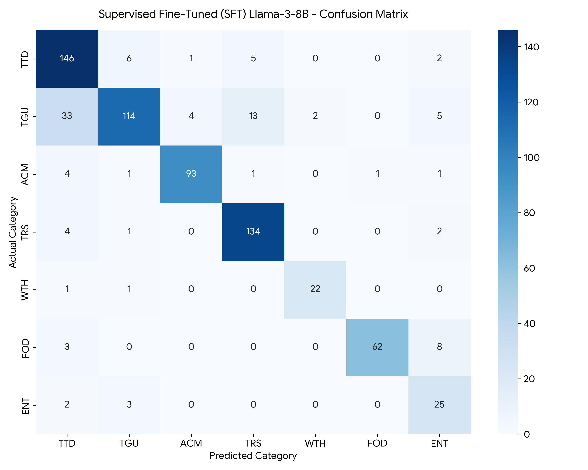

# Domain-Specific Intent Classification for Travel Queries via Llama-3-8B & QLoRA

[](https://colab.research.google.com/github/<YOUR-GITHUB-USERNAME>/travel-query-classification-llama3-lora/blob/main/notebooks/Llama3_8B_PEFT_Travel_Classification.ipynb)
[](https://www.python.org/downloads/)
[](https://pytorch.org/)
[](https://github.com/unslothai/unsloth)
[](https://opensource.org/licenses/MIT)

## Overview

Automated intent classification in the travel domain is challenging due to high semantic overlap across user queries (e.g., distinguishing general travel guides from specific transit routes or entertainment venues). Traditional machine learning pipelines rely heavily on brittle, hand-crafted syntactic features.

This project implements an end-to-end **In-Context Learning (ICL) and Parameter-Efficient Fine-Tuning (PEFT / QLoRA)** benchmarking pipeline using **Llama-3-8B-Instruct** accelerated via **Unsloth**. Evaluated on a 5,000-sample travel question dataset across 7 coarse-grain taxonomies, Supervised Fine-Tuning (SFT) improves **Macro F1 from 46.38% (Zero-Shot) to 85.06%**, resolving severe class boundary ambiguities while running entirely within a 16 GB VRAM budget (NVIDIA T4).

---

## Taxonomy & Dataset Architecture

The pipeline ingests the 5,000 Travel Questions Dataset (Kahaduwa et al., 2017) directly from its upstream source and classifies queries into seven coarse-grain categories:

| Code | Category | Example Domain Scope |
| :--- | :--- | :--- |
| **`TTD`** | Things To Do | Sightseeing, activities, excursions, tours, attractions |
| **`TGU`** | Travel Guide | General trip planning, visa/safety advice, regional itineraries |
| **`ACM`** | Accommodation | Hotels, resorts, hostels, lodging bookings, amenities |
| **`TRS`** | Transport | Flights, rental cars, ferries, train schedules, local transit |
| **`WTH`** | Weather | Seasonal climate, rainfall, temperature forecasts |
| **`FOD`** | Food | Restaurants, local cuisine, dining recommendations |
| **`ENT`** | Entertainment | Nightlife, live shows, concerts, clubs, theater tickets |

### Stratified Splitting & Leakage Prevention
To guarantee rigorous evaluation across imbalanced classes, the dataset is partitioned using two-stage stratified sampling (`random_state=42`):
* **Training Set:** 4,000 samples (80.0%)
* **Validation Set:** 300 samples (6.0%) — Used for prompt A/B testing and in-training `eval_loss` checkpointing.
* **Test Set:** 700 samples (14.0%) — Held out strictly for final evaluation.

---

## System Architecture & Engineering Decisions

### 1. Base Model Selection (`Llama-3-8B-Instruct`)
* **Architecture Specs:** 128,256-token Tiktoken BPE vocabulary, 8,192-token native context window, pre-trained on >15T tokens, utilizing **SwiGLU** activations, **Grouped-Query Attention (GQA)** with 8 KV heads to minimize KV-cache memory bandwidth overhead, and **Rotary Position Embeddings (RoPE)**.
* **Quantization (4-bit NF4):** Loaded via `bitsandbytes` NormalFloat4 (NF4) quantization, compressing the base model memory footprint from ~16 GB (FP16) to **~5.5 GB**, enabling training and batched inference on consumer/cloud T4 GPUs.

### 2. Prompt Engineering & Dynamic Chat Templating
An empirical A/B validation test demonstrated that providing explicit taxonomy definitions outperforms minimal label lists. The system enforces strict Llama-3 control tokens (`<|begin_of_text|>`, `<|start_header_id|>`, `<|eot_id|>`) alongside three structural constraints:
1. **Persona Grounding:** Primes autoregressive attention heads specifically for travel taxonomy classification.
2. **Semantic Mapping:** Explicitly bridges 3-letter codes (`TRS`, `ACM`) to natural language definitions.
3. **Negative Output Constraints:** Restricts output strictly to the 3-letter code with deterministic decoding (`temperature=0.0`, `do_sample=False`, `max_new_tokens=5`), eliminating conversational filler.

### 3. QLoRA & SFT Configuration
Rather than adapting only attention heads, low-rank adapters (`41,943,040` trainable parameters, **0.52%** of total weights) are injected across all attention and MLP linear projections:

| Parameter | Configuration | Engineering Justification |
| :--- | :--- | :--- |
| **LoRA Rank ($r$) & Alpha ($\alpha$)** | `r = 16`, `lora_alpha = 16` | Scaling factor $\alpha/r = 1.0$ provides expressive capacity for 7-class boundary adaptation without catastrophic forgetting. |
| **Target Modules** | `q_proj`, `k_proj`, `v_proj`, `o_proj`, `gate_proj`, `up_proj`, `down_proj` | Adapting both self-attention and SwiGLU MLP projections maximizes classification accuracy. |
| **Optimizer** | `adamw_8bit` | Quantizes first and second moment states to 8-bit, slashing optimizer VRAM overhead by ~75% without convergence degradation. |
| **Batching & Gradient Checkpointing** | `batch_size = 2`, `grad_accum = 4` (Effective = 8) | Paired with Unsloth gradient checkpointing to prevent CUDA Out-Of-Memory (OOM) spikes. |
| **Learning Rate & Regularization** | `lr = 2e-4` (Linear), `weight_decay = 0.01` | 10-step warmup followed by linear decay over 120 steps with $L_2$ regularization. |
| **Checkpoint Strategy** | `eval_steps = 20`, `load_best_model_at_end = True` | Tracks validation loss every 20 steps and automatically restores the optimal weights. |

---

## Experimental Results & Benchmark Analysis

All four configurations were evaluated across the 700-sample stratified test set:

| Category | Zero-Shot F1 | 1-Shot F1 | 3-Shot F1 | **SFT (QLoRA) F1** | **$\Delta$ (Zero-Shot $\rightarrow$ SFT)** |
| :--- | :---: | :---: | :---: | :---: | :---: |
| **`TTD` (Things To Do)** | 0.4095 | 0.5150 | 0.6687 | **0.8272** | +41.77% |
| **`TGU` (Travel Guide)** | 0.0457 | 0.1773 | 0.1466 | **0.7677** | **+72.20%** |
| **`ACM` (Accommodation)** | 0.7167 | 0.8497 | 0.8762 | **0.9347** | +21.80% |
| **`TRS` (Transport)** | 0.7348 | 0.5726 | 0.8025 | **0.9116** | +17.68% |
| **`WTH` (Weather)** | 0.8302 | 0.7273 | 0.5393 | **0.9167** | +8.65% |
| **`FOD` (Food)** | 0.7582 | 0.7714 | 0.6064 | **0.9118** | +15.36% |
| **`ENT` (Entertainment)** | 0.2157 | 0.4211 | 0.4250 | **0.6849** | +46.92% |
| **Macro Average F1** | 0.4638 | 0.5764 | 0.5807 | **0.8506** | **+38.68%** |
| **Weighted Average F1** | 0.4730 | 0.5224 | 0.5767 | **0.8509** | **+37.79%** |

### Confusion Matrix (SFT Model)



### Key Analytical Insights
1. **The Travel Guide (`TGU`) Breakthrough (+72.2% F1):** In zero-shot and few-shot regimes, the base model failed to grasp the dataset-specific scope of `TGU` (0.0457 F1), frequently collapsing general itinerary queries into `TTD` or `TRS`. SFT aligned internal representations to achieve **0.7677 F1**.
2. **In-Context Learning Limitations:** While 1-shot and 3-shot prompting improved syntax compliance and lifted Macro F1 to ~0.58, few-shot prompting exhibited recency bias toward the exemplar classes and degraded performance on minority classes like `WTH` (dropping from 0.8302 to 0.5393 in 3-shot).
3. **100% Syntax Compliance & Boundary Resolution:** Post-SFT, the model achieved 100% formatting compliance across all 700 test samples and cleanly separated ambiguous queries:
   * *"Can I take my girlfriend on a trip to Pakistan with no discomfort or problems?"* $\rightarrow$ Zero-Shot: `TRS` (triggered by "trip") | **SFT: `TGU` (Correct)**
   * *"What are the best Rental Car Agencies in Siena?"* $\rightarrow$ Zero-Shot: `ACM` | **SFT: `TRS` (Correct)**

---

## Production Scaling & Next-Gen Roadmap

To transition this classifier into a high-throughput enterprise production service, the following architectural extensions are recommended:

* **Reference-Free Preference Optimization (KTO / SimPO):** Standard DPO requires paired preference data $(y_w, y_l)$ and doubles VRAM usage by holding an active reference model ($\pi_{ref}$). Adopting **SimPO** eliminates the reference model via average log-likelihood margin rewards, while **KTO** enables continuous alignment directly from unpaired binary production feedback logs.
* **Hybrid RAG Integration:** For real-time travel routing and dynamic venue lookup, combining **Qdrant** (for concurrent Rust-based HNSW vector search and metadata payload filtering) with **BGE** embeddings and **Hybrid Retrieval (Dense Vector + Sparse BM25 with Reciprocal Rank Fusion)** ensures both semantic comprehension and exact keyword matching (flight numbers, hotel names).
* **Latency Acceleration via Speculative Decoding:** To overcome memory-bandwidth bottlenecks during autoregressive generation, pairing the 8B target model with a lightweight 1B draft model via **Speculative Decoding** yields a mathematically lossless $2\times\text{–}3\times$ wall-clock inference speedup.

---

## Repository Structure

```text
travel-query-classification-llama3-lora/
├── notebooks/
│   └── Llama3_8B_PEFT_Travel_Classification.ipynb   # End-to-end training & evaluation pipeline
├── results/
│   ├── final_experiment_metrics.csv                 # Class-wise & Macro/Weighted F1 benchmarks
│   ├── all_model_predictions.csv                    # 700 test samples with side-by-side predictions
│   └── sft_confusion_matrix.png                     # High-res confusion matrix heatmap
├── .gitignore                                       # Standard Python/CUDA artifact exclusions
├── requirements.txt                                 # Pinned environment dependencies
├── LICENSE                                          # MIT License
└── README.md                                        # Project documentation & architectural whitepaper
```

## Quickstart
Launch in Google Colab (Recommended): Click the Open in Colab badge at the top of this README, select a T4 GPU runtime, and execute the cells sequentially.

Local Execution:

```Bash
git clone [https://github.com/](https://github.com/)<YOUR-GITHUB-USERNAME>/travel-query-classification-llama3-lora.git
cd travel-query-classification-llama3-lora
pip install -r requirements.txt
jupyter notebook notebooks/Llama3_8B_PEFT_Travel_Classification.ipynb
```

## References
Dettmers, T., et al. (2024). QLoRA: Efficient Finetuning of Quantized LLMs. NeurIPS.

Dubey, A., et al. (2024). The Llama 3 Herd of Models. arXiv:2407.21783.

Ethayarajh, K., et al. (2024). KTO: Model Alignment as Prospect Theoretic Optimization. arXiv:2402.01306.

Hu, E. J., et al. (2021). LoRA: Low-Rank Adaptation of Large Language Models. arXiv:2106.09685.

Kahaduwa, H., et al. (2017). Question Answering System for the Travel Domain. IEEE MERCon.

Leviathan, Y., et al. (2023). Fast Inference from Transformers via Speculative Decoding. ICML.

Meng, Y., et al. (2024). SimPO: Simple Preference Optimization with a Reference-Free Objective. arXiv:2405.14734.
